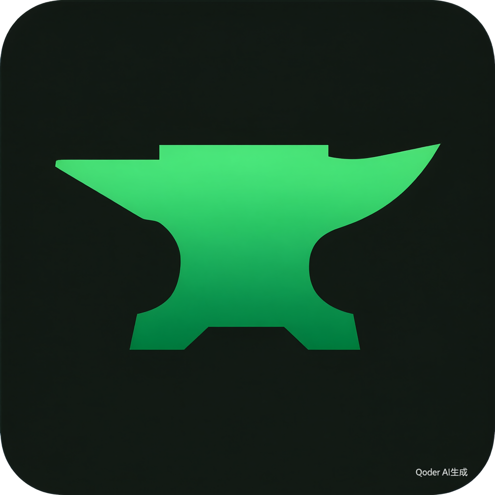
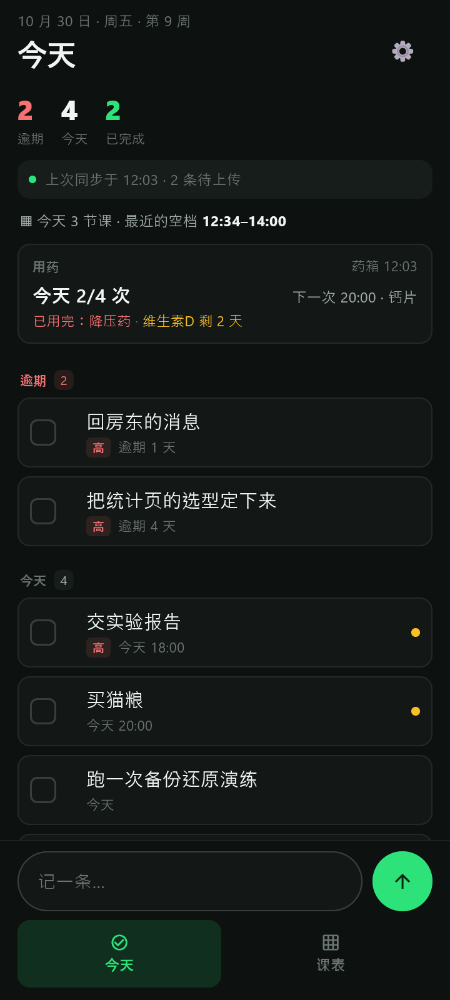
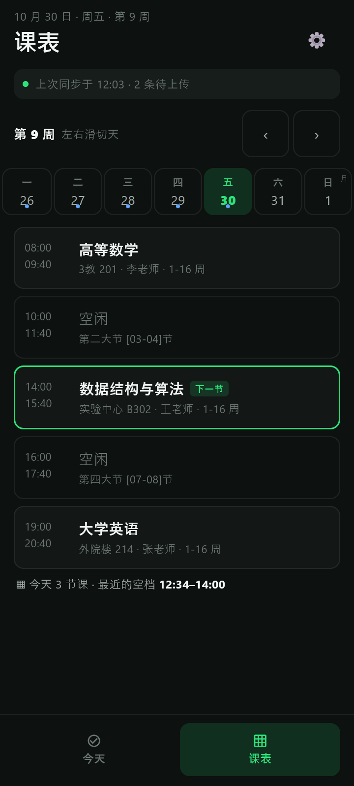

<p align="center">
  
</p>

<h1 align="center">Anvil · 工作台</h1>

<p align="center">
本地优先的个人工作台：桌面端管理每一天，Android 伴侣负责出门在外时的待办、课表与用药进度。
</p>

---

## 这是什么

**桌面端**（Tauri 2 + Vue 3 + Rust + SQLite）把一天里分散的东西放进同一屏：

- **今天**：待办队列、课表空档、倒计时、便签、速达、系统资源
- **待办 / 课表 / 日历 / 笔记 / 进度 / 统计**
- **外部联动**：博客仓库 JSON、药箱 SQLite（只读副本）、坚果云每日备份
- **每日备份**：AES-256-GCM 信封加密后上传坚果云，凭据进 Windows 凭据管理器

**Android 伴侣**（Flutter + SQLite）：

- 看待办、勾选完成、新建待办
- 看课表（单日竖列，课名全文可读）
- **只读**看手机药箱的今日用药进度与库存
- 打开 App 时同步一次 + 手动同步；不假装实时

## 界面

| 今天（含用药卡） | 课表 |
|---|---|
|  |  |

> 截图与演示数据都是编的，不含真实个人信息。

## 架构

```
┌──────────────┐    HTTPS WebDAV    ┌────────────┐    HTTPS WebDAV    ┌──────────────┐
│   桌面 Anvil  │ ─────────────────▶ │   坚果云    │ ◀───────────────── │ Android 伴侣  │
│ Tauri + Rust  │                    │ 三个独立目录 │                    │   Flutter     │
└──────────────┘                    └────────────┘                    └──────────────┘
        │                                   │                                  │
        │ workbench-backup/  每日备份（加密信封）                              │
        │ workbench-sync/    待办/课表对等同步（加密信封，行级 LWW）            │
        │ medicine-sync/     药箱 App 自己的目录（Anvil 只读，不写）           │
```

几条硬边界写在代码里，不靠自觉：

- 三个目录在类型层隔离：备份客户端不列 `device-*`，同步客户端拒绝别的目录，药箱只读客户端只有 `PROPFIND/GET`。
- 待办对等合并：整行替换、`updated_at` 先比、平票比设备号；墓碑永不清理，旧快照不会让已删的行复活。
- 课表单向：桌面导入、手机只读；学期与开学日作为白名单 `meta` 随快照走。
- 药箱只读：不写它的库、不写它的 `medicine-sync/`、不读它自己存的密码。

## 仓库结构

| 路径 | 内容 |
|---|---|
| `src/` | 桌面 UI（Vue 3 + TypeScript + Vite） |
| `src-tauri/` | Rust 后端：SQLite 迁移、命令、备份、同步、外部联动 |
| `mobile/` | Android 伴侣（Flutter），含同步客户端与药箱只读视图 |
| `docs/` | 计划、状态记录、精选截图 |
| `design/` | 决策前后的 HTML 对比稿与美术源 |
| `tools/` | 截图、逐图核对、WebDAV 桩等取证脚本 |
| `.github/workflows/` | 推 `v*` tag 时自动构建桌面安装包与 Android APK |
| `shots/` | 本机取证截图（**不入库**，README 用 `docs/images/` 那两张） |

## 快速开始

### 桌面端

前置：Node.js 20+、Rust stable、Windows 上需要 WebView2 与 MSVC C++ 构建工具。

```bash
npm install
npm run tauri:dev      # 开发
npm run tauri:build    # 打包
```

### Android 伴侣

前置：Flutter 3.47+（Dart 3.13+）、Android SDK。

```bash
cd mobile
flutter pub get
flutter test
flutter run -d <device>
flutter build apk --release
```

### 测试

```bash
npm run typecheck
npm test                 # 前端单测（Vitest）
npm run lint:style       # 设计令牌与反网页感静态检查
cd src-tauri && cargo test
cd mobile && flutter test && flutter analyze
```

## 发布

推一个 `v*` tag 就会触发 [.github/workflows/release.yml](.github/workflows/release.yml)：

```bash
git tag v0.1.0
git push origin v0.1.0
```

工作流会并行构建并挂到同一个 GitHub Release：

- `Anvil-<tag>-x64-setup.exe`（Windows NSIS）
- `Anvil-<tag>-android.apk`（Android，通用 APK）

在 Actions 页面手动运行同一工作流是**干跑**：只产出 workflow artifacts，不建 Release。

> 目前产物**未做发布签名**：Windows 首次运行会弹 SmartScreen；APK 使用 debug 签名（仅自用/侧载），而且每个 runner 生成的 debug 证书不同，**跨版本安装要先卸载旧版**。应用内自动更新不在当前范围。

## 数据与隐私

- 没有账号系统、没有遥测、没有第三方分析。
- 桌面数据在本机 SQLite；上传前加密，云端只看到 `ANVILBKP` 开头的密文。
- 药箱的 `medicine-sync/` 是药箱 App 自己的格式（明文 JSON）；Anvil 只读，不写，也不读药箱保存的密码。
- 凭据分别存放在 Windows 凭据管理器与 Android Keystore，不落数据库。

## 文档

- [docs/README.md](docs/README.md) — 文档索引与阅读顺序
- [docs/PLAN.md](docs/PLAN.md) — 桌面端计划与已拍板的取舍
- [docs/PLAN-MOBILE.md](docs/PLAN-MOBILE.md) — 手机端计划（同步模型、UI 定稿、里程碑）
- [docs/PROGRESS.md](docs/PROGRESS.md) — 按时间记录做了什么、验了什么、哪里还没验

## 状态

桌面端 M0–M10 已落地；手机端 M11a–M11e 已落地（数据层、同步客户端、两屏 UI、药箱只读视图）。
真机侧还剩：实体 Android 设备、真实坚果云账号的成功往返、配额实测。详见 `docs/PLAN-MOBILE.md` §6–§7。

## 许可

本仓库尚未选择开源许可证。公开发布或允许他人分发前，请先确定许可方式。
