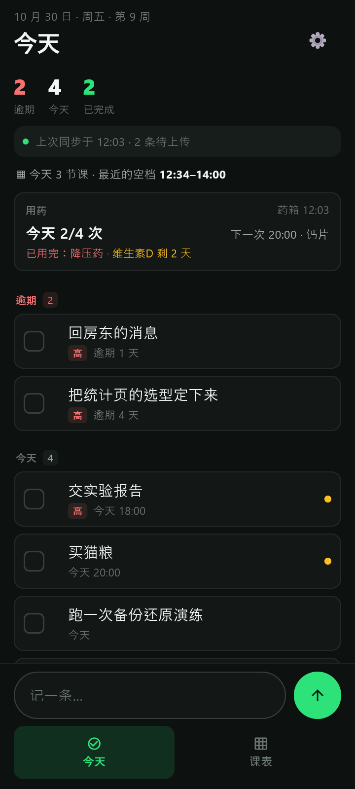
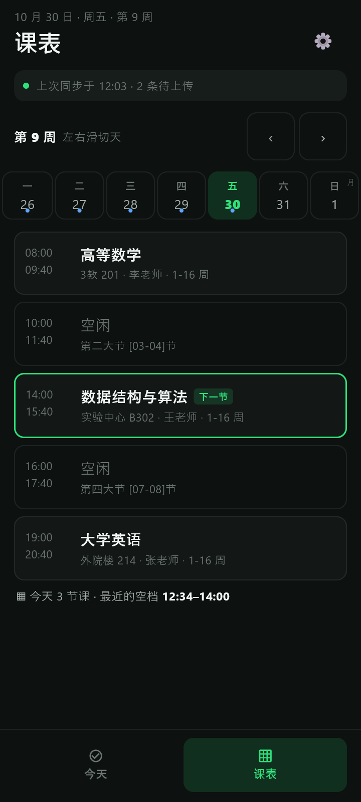

# Anvil Mobile（Android 伴侣）

桌面端 [Anvil](../README.md) 的手机侧。范围刻意很小：**看待办、勾选完成、新建待办、看课表、看手机药箱的今日用药进度（只读）**。

| 今天 | 课表 |
|---|---|
|  |  |

> 界面与数据都是演示用的假数据。

## 目录

| 路径 | 内容 |
|---|---|
| `lib/app.dart` | 应用根：主题、两屏导航 |
| `lib/ui/` | 今天屏、课表屏、设置页、用药卡与通用部件 |
| `lib/store.dart` | 界面状态（内存投影） |
| `lib/db.dart` / `repo.dart` | SQLite 建表与读写；设备 id、同步状态、药箱缓存 |
| `lib/sync/` | 同步信封、快照、合并、WebDAV 客户端、同步引擎；药箱只读客户端 |
| `lib/medicine.dart` | 药箱规则移植（时间点、库存天数、今日进度） |
| `lib/credentials.dart` | 应用密码进 Android Keystore |
| `lib/shot.dart` | 360×800 取证截图（`ANVIL_SHOT`） |
| `test/` | 122 条测试（20 个文件）：布局数字、合并规则、同步 e2e、药箱规则与卡片、相对时间、同步失败与启动失败那两屏 |
| `tool/` | 跨语言快照向量的产出脚本 |
| `third_party/` | 见下方「Windows 取证构建」 |

## 开发

```bash
flutter pub get
flutter test
flutter analyze
flutter run -d <device>
flutter build apk --release
```

首次启动会创建 SQLite 库；同步与药箱读取在设置页配置。药箱默认复用同步那组账号，药箱在另一个坚果云账号时在「药箱账号」里单独填。

## 同步与只读边界

- 工作台数据：`/dav/workbench-sync/device-<设备号>.enc`，各设备只覆盖自己那份；整行 LWW 合并、墓碑随行传播。手机只发布 `todos`，`classes` 单向 PC→手机。
- 药箱数据：`/dav/medicine-sync/device-*.json`，**只读**（客户端只有 PROPFIND/GET），合并规则照药箱：`updated_at` 新的赢，平票按发布更晚/设备号，墓碑不显示。
- 界面只说可验证的事实：「上次同步于 31 分钟前 · N 条待上传」「药箱 3 天前」；不出现「已同步」或转圈。时间一律走 `agoLabel`（与桌面 `relTime` 同形状，越远越具体），**不要退回光秃秃的钟点** —— 「12:03」会被读成"今天 12:03"，而那份数据可能是上周的。
- 同步的时机是刻意的窄口径：**只有打开 App 那一次**加上设置页手动点。回前台不刷、不定时（`../docs/PLAN-MOBILE.md` §1 否掉后台定时，"回前台也不刷"是同一取舍的另一半，2026-11-02 决定维持），所以界面必须把口径说出口，见「立即同步」那一行。

## 取证截图

窗口截图会把 360×800 挤掉几十像素，所以用 `RepaintBoundary` 精确出图：

```bash
flutter run -d windows \
  --dart-define=ANVIL_DEMO=med \
  --dart-define=ANVIL_THEME=dark \
  --dart-define=ANVIL_SHOT=../shots/m11e-medicine-360-dark.png
```

`ANVIL_DEMO` 可选 `full` / `undo` / `empty` / `first` / `offline` / `med`。

## 两个本机构建注记

- **`third_party/flutter_secure_storage_windows`**：该包的 Windows 实现要 Visual Studio 的 ATL（`atlstr.h`），本机工具链没装，会把 Windows 取证构建挡死。这里放同一版本的本地副本，只去掉 C++ 插件、保留 Dart FFI 实现；Android 仍用主包的 Keystore 实现。这是取证链的补丁，不是加密方案改动。
- **`pubspec.yaml` 的 `hooks.user_defines.sqlite3`**：`sqflite_common_ffi` 只是测试依赖，但原生资产钩子会在 App 构建时也跑。Windows 用系统 `winsqlite3.dll`，Android 指到系统库，避免构建时去 GitHub 下载二进制；App 运行时走 sqflite 平台通道，不会碰它。

## 发布签名

release APK 用固定 keystore 签名：本机文件在 `mobile/.signing/anvil-release.jks` + `mobile/android/key.properties`（两者被忽略）；CI 从 `ANDROID_KEYSTORE_BASE64` / `ANDROID_KEYSTORE_PASSWORD` / `ANDROID_KEY_ALIAS` / `ANDROID_KEY_PASSWORD` 四个 secrets 还原。没有 key.properties 时回退 debug 证书。

## 图标

源图是 `assets/app-icon.png`（已清掉水印的透明版）。改图后跑：

```bash
cp ../design/refs/anvil-app-icon-transparent.png assets/app-icon.png
dart run flutter_launcher_icons
```

桌面图标用 `npx tauri icon design/refs/anvil-app-icon-transparent.png` 重新生成。

## 已知限制

- 只做 Android；没有 iOS 工程。
- 没有后台定时同步与桌面小组件：同步发生在打开 App 或手动点「立即同步」时。
- 药箱只读：打卡仍回药箱；Anvil 不写药箱的库或同步目录。
- 本地库 `anvil.db` 是**明文**，这是已定的口径而不是遗漏：加密只在出门的信封那一层，系统备份与换机迁移已全关。理由与"什么时候才重新考虑"写在 `../docs/THREAT-MODEL.md`。
- 真实 Android 设备、真实坚果云账号的成功往返仍待验收（`../docs/PLAN-MOBILE.md` §7）。
